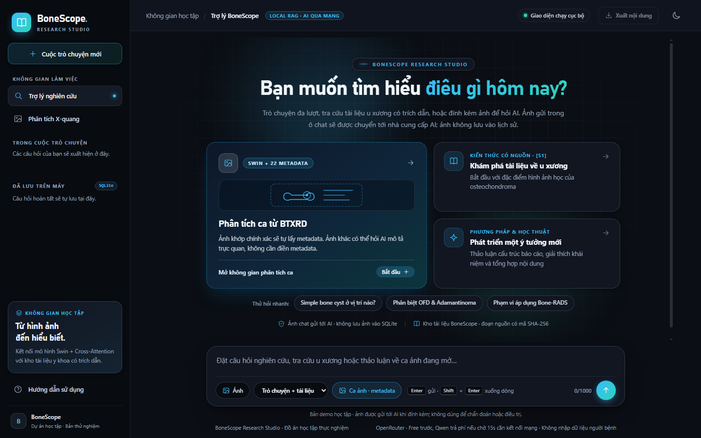

<h1 align="center">BoneScope</h1>

<p align="center">An educational research studio for bone X-ray classification and source-backed document exploration.</p>

<p align="center">
  
  
  
</p>

<p align="center">
  <a href="README_VI.md">Hướng dẫn tiếng Việt</a> ·
  <a href="docs/reports/BAO_CAO_TONG_KET_DO_AN_BONESCOPE_20261113_VI.md">Coursework report</a> ·
  <a href="docs/reports/BAO_CAO_KIEN_THUC_KY_NANG_VA_TIEN_DO_BONESCOPE_20261114_VI.md">Skills and project timeline</a> ·
  <a href="docs/reports/PRODUCT_ACCEPTANCE_CHECKLIST_VI.md">Demo checklist</a>
</p>



*Research Studio home screen on Windows.*

## What you can try

| Workspace | What it does |
| --- | --- |
| **X-ray Workbench** · port 8000 | Upload an authorized X-ray with 22 metadata fields. A local Swin model combines image and metadata features through cross-attention and returns ranked labels and softmax scores. |
| **Research Studio** · port 8765 | Browse 22 sources and 794 passages in the local lookup mode. Configure OpenRouter for generated answers and image chat. SQLite keeps conversation text and source references on the machine. |

BoneScope is a local coursework prototype. The classifier is intended for educational experiments, and the chat interface is intended for exploring the reference collection. Use synthetic or authorized samples and keep patient data out of the demo.

## Run on Windows

Install **Python 3.11 (64-bit)** with the Python Launcher, **Git**, and **Git LFS**. The classifier supports CPU and CUDA. Run the commands from PowerShell.

```powershell
git lfs install
git clone https://github.com/Minh1337/Bone-Xray.git
cd Bone-Xray
git lfs pull
.\scripts\01_setup.bat
```

Git LFS supplies the checkpoint in `model/best_model.pt`. The setup script creates `.venv` and installs the base model dependencies.

**X-ray Workbench**

```powershell
.\scripts\04_setup_api.bat
.\scripts\07_start_ui.bat
```

Open [the X-ray Workbench](http://127.0.0.1:8000/) or its [API documentation](http://127.0.0.1:8000/docs). See the [Windows guide](README_VI.md) for the image and metadata workflow.

**Research Studio**

```powershell
.\scripts\10_setup_chatbot.bat
.\.venv\Scripts\python.exe -m rag.build_index --download-model
.\.venv\Scripts\python.exe -m tools.chatbot_doctor
.\scripts\08_start_chatbot.bat
```

Open [Research Studio](http://127.0.0.1:8765/) and select **Tra cứu cục bộ** for a source lookup without an API key. This mode also keeps explanations of local X-ray model outputs on the machine. The first index build downloads the pinned multilingual E5 model. The same lookup is available in the terminal. See the [RAG guide](docs/guides/README_RAG_INDEX_VI.md) for audit and replay commands.

```powershell
.\.venv\Scripts\python.exe -m rag.retrieval "What is osteochondroma?" --top-k 5
```

To enable generated answers, copy [`.env.example`](.env.example) to `.env`, set `OPENROUTER_API_KEY`, and restart the app. The configured free route is tried first and the Qwen fallback can incur charges. The [provider guide](docs/guides/OPENROUTER_CHATBOT_SETUP_VI.md) describes the routing and setup.

## Experiment results

The report compares the same checkpoint on **250 BTXRD images**, with 25 images per label. The second run replaces the metadata input vector with zeros to measure how strongly the checkpoint depends on it.

| Input condition | Top-1 accuracy | Top-3 accuracy | Macro-F1 |
| --- | ---: | ---: | ---: |
| Image + metadata | 77.6% (194/250) | 94.0% (235/250) | 0.776 |
| Image + zeroed metadata vector | 48.0% (120/250) | 72.0% (180/250) | 0.439 |

These results describe an **in-source experiment**. The checkpoint was trained on BTXRD, and the original split cannot be reconstructed from the available records. The [coursework report](docs/reports/BAO_CAO_TONG_KET_DO_AN_BONESCOPE_20261113_VI.md) explains the sampling, class results, and limits. See the [evaluation record](docs/reference/stage11_xray_in_source_evaluation_20261103.json) for the saved results.

The November 12 verification recorded **3/3 local reference cases** for API parity and **16/16 matching RAG replays**. The regression suite passed 213 tests with one browser test skipped in the sandbox. That browser test passed in a separate run using an isolated database, synthetic images, and mocked AI. See the [verification record](docs/reference/project_verification_20261112.json) and the [demo checklist](docs/reports/PRODUCT_ACCEPTANCE_CHECKLIST_VI.md).

The November 13 report review reran the suite on the current code: **216 passed, 1 skipped, 227 subtests passed**. The isolated Chrome smoke test passed separately; RAG audit and replay passed again. See the [report verification record](docs/reference/project_report_verification_20261113.json) and the [Word report](docs/reports/BAO_CAO_TONG_KET_DO_AN_BONESCOPE_20261113_VI.docx).

## Data flow and research status

- X-ray classification and vector search run locally. Generated chat may send the prompt, recent conversation, selected passages, or a minimal case summary to the configured provider. Attaching an image to chat sends the image to that provider.
- Conversation text and source references persist in local SQLite. Chat attachments stay in the browser tab and are discarded on reload.
- Retrieval scores rank candidate passages, and the classifier returns uncalibrated softmax scores. Independent review of answer support and an external image evaluation remain open. The research status is `answer_ready=false`, with gates G1–G7 open.

See the [source registry](rag/data/sources.json), [image data guide](docs/guides/README_IMAGE_REFERENCE_VI.md), and [research status](docs/reference/STAGE11_EDUCATIONAL_COMPLETION_MATRIX_20261029.md) for provenance, reuse terms, and evaluation limits.

## Repository map

| Path | Contents |
| --- | --- |
| [`bonescope/`](bonescope/) · [`xray_web/`](xray_web/) | Local classifier, FastAPI endpoints, and X-ray Workbench |
| [`rag/`](rag/) | Retrieval, provider routing, conversation storage, and Research Studio |
| [`scripts/`](scripts/) · [`tools/`](tools/) | Windows launchers, verification, and research utilities |
| [`docs/`](docs/) | Reports, source records, setup guides, and handoff |

After setting up both workspaces, install the test dependencies and run the regression suite.

```powershell
.\.venv\Scripts\python.exe -m pip install -r requirements_dev.txt
.\.venv\Scripts\python.exe -m pytest api_tests rag/tests tests ui_tests -q
```

The browser smoke test uses an installed Chrome or Chromium and mocked provider calls. Use the [demo checklist](docs/reports/PRODUCT_ACCEPTANCE_CHECKLIST_VI.md) to rehearse the presentation and the [handoff notes](START_HERE_NEXT_CODEX_VI.md) to continue development.
